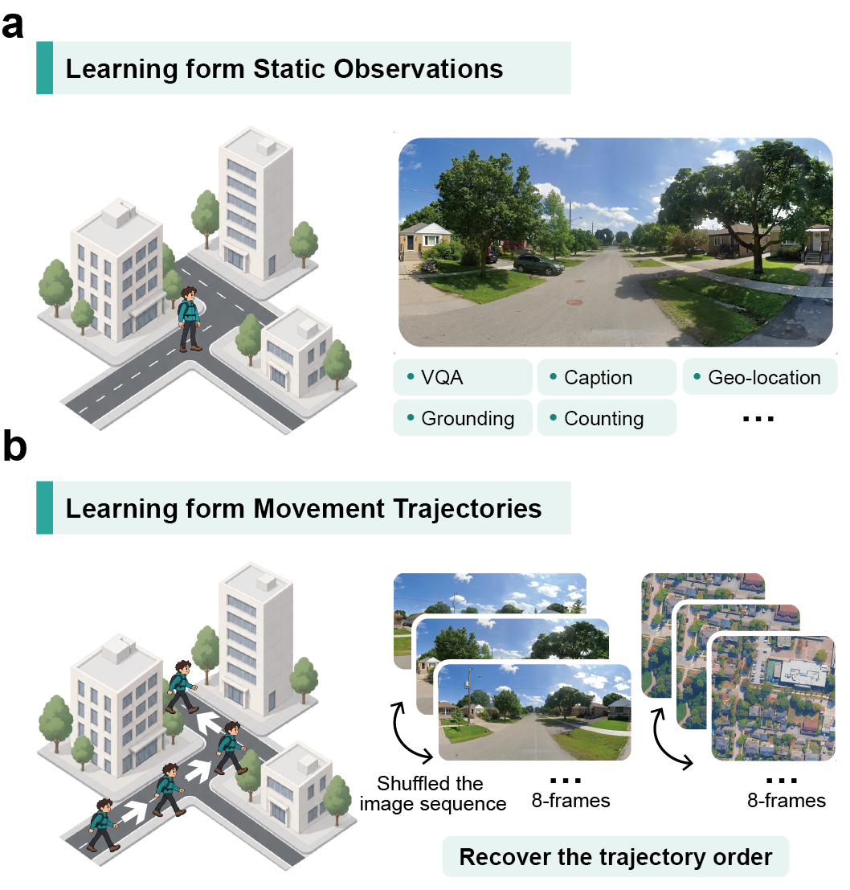
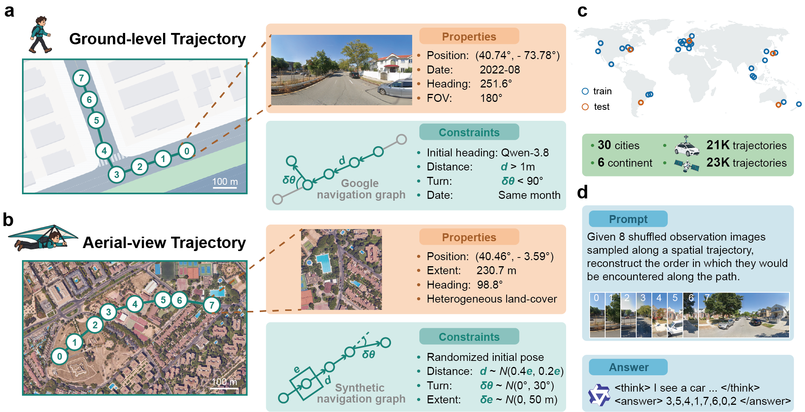
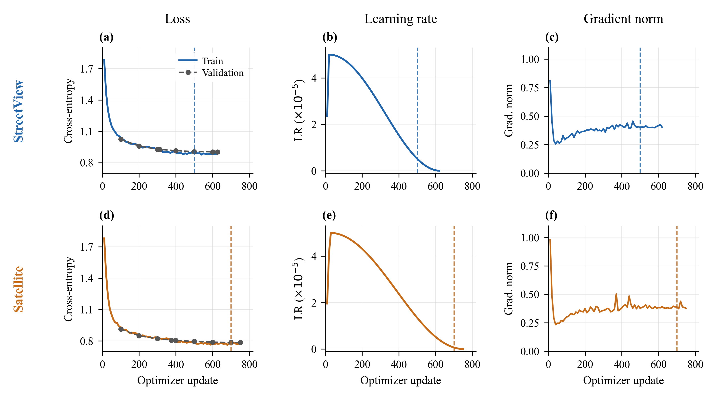
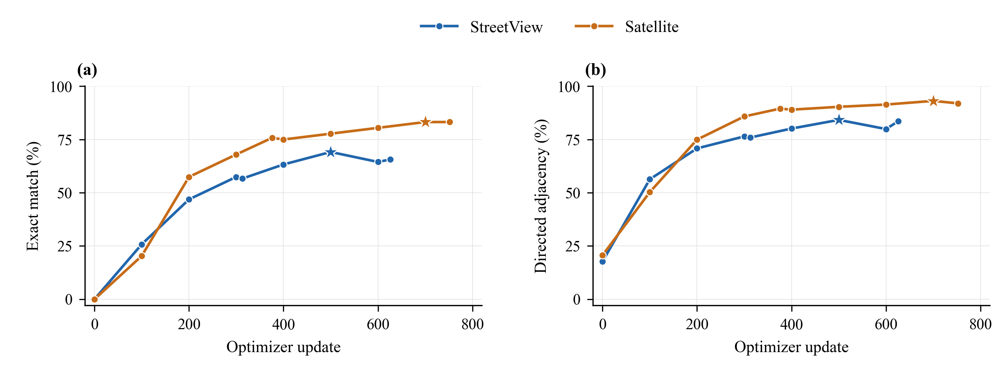
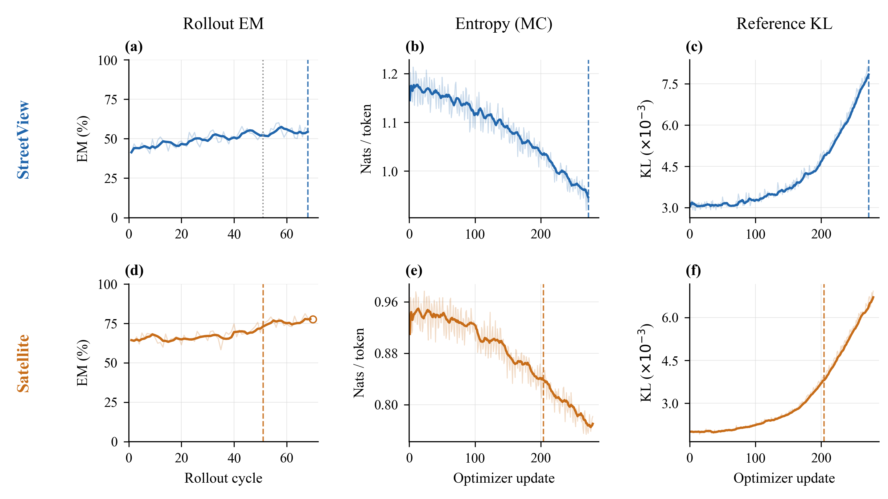
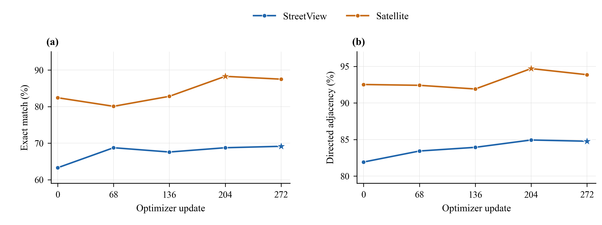

# Learning from Movement

### Visual trajectory reconstruction from ground-level and aerial observations

**Learning from Movement** studies whether vision–language models can recover spatial progression from an unordered sequence of observations. Given eight images sampled along a movement trajectory, a model must infer the order in which the views would be encountered. The task requires reasoning across viewpoints, recurring landmarks, scene geometry, and local spatial continuity.

The project contains two independent image modalities—**StreetView** and **Satellite**—and a post-training pipeline comprising **supervised fine-tuning (SFT)** followed by **GRPO + on-policy self-distillation (OPSD)** with a frozen, ground-truth-privileged teacher.

This repository releases the core generation, training, evaluation, and visualization code, experiment descriptions, aggregate results, and selected paper figures. **Images forming the datasets, teacher records, model weights, checkpoints, raw predictions, training logs, and run directories are excluded.**

## Contents

1. [Motivation and task](#1-motivation-and-task)
2. [Dataset construction](#2-dataset-construction)
3. [Training methodology](#3-training-methodology)
4. [Evaluation protocol](#4-evaluation-protocol)
5. [Results and training dynamics](#5-results-and-training-dynamics)
6. [Code organization](#6-code-organization)
7. [Reproduction and dependencies](#7-reproduction-and-dependencies)
8. [Scope and limitations](#8-scope-and-limitations)

## 1. Motivation and task

### 1.1 From individual observations to spatial progression

Individual images provide evidence about objects and places. Sequences collected along a path additionally expose how viewpoints, landmarks, and visibility change with movement. Trajectory reconstruction turns this cross-view information into a verifiable ordering problem, with an exact ground-truth permutation.

<p align="center">
  
</p>

*Figure 1. Project motivation: reconstructing movement order from shuffled ground-level or aerial observations.*

### 1.2 Task definition

Each example consists of eight images presented with labels `Image 0` through `Image 7`. The labels refer to **presentation positions**, not original chronological frame numbers.

Let `s[k]` denote the original frame index of the image presented as `Image k`. The required output is the inverse permutation:

```text
ground_truth_order = argsort(s)
```

The model produces a structured four-step rationale within `<think>...</think>` and an ordering within `<answer>...</answer>`. Coordinates, route IDs, source filenames, and chronological frame indices are withheld from the model text. Ground-truth order is supplied only to the privileged OPSD teacher during training.

StreetView and Satellite are **separate experiments** with independent trajectories and adapters. They share a task formulation and city split; their examples are not paired across modalities.

## 2. Dataset construction

### 2.1 Ground-level and aerial trajectories

<p align="center">
  
</p>

*Figure 2. Dataset overview: ground-level trajectories, aerial trajectories, geographic coverage, and the reconstruction interface. Rounded trajectory counts in the illustration are resolved by the exact counts below.*

**StreetView.** Eight-frame sequences follow panorama navigation links within city boundaries. Construction checks movement, heading continuity, capture-time consistency, and panorama uniqueness. The formal dataset contains **21,674 trajectories / 173,392 images**.

**Satellite.** Eight-frame sequences follow independently sampled aerial camera paths within the same city boundaries. The v4 sampler varies heading and footprint extent using bounded distributions; a land-cover filter removes trajectories containing a frame occupied entirely, among valid pixels, by one non-built class. The final dataset contains **23,435 trajectories / 187,480 images**.

Training images are stored at **1024 × 512** for StreetView and **768 × 768** for Satellite. With the shared processor pixel budget, Satellite inputs are processed at **704 × 704**. Each trajectory contributes 4,096 and 3,872 visual tokens, respectively.

### 2.2 Geographic split and training subsets

The dataset covers **30 cities**. Training uses 23 cities; **Toronto and Vienna** are held out for validation. The five-city out-of-distribution (OOD) split contains **Berlin, Buenos Aires, Melbourne, Osaka, and Philadelphia**.

| Split / use | StreetView | Satellite |
|---|---:|---:|
| Complete dataset | 21,674 | 23,435 |
| All trajectories in training cities | 16,704 | 17,452 |
| Quality-filtered teacher CoT for SFT | 9,999 | 12,021 |
| CoT-qualified loss validation | 932 | 1,143 |
| Complete generation validation | 1,445 | 1,684 |
| Fixed checkpoint-selection probe | 256 | 256 |
| Complete five-city OOD evaluation | 3,525 | 4,299 |

The probe contains 128 fixed examples from each validation city and is a subset of complete validation. Within each modality, train, validation, and OOD trajectory IDs are disjoint.

SFT uses teacher records that pass answer correctness, strict rationale-format, successful completion, and reasoning-length checks. GRPO + OPSD uses **all trajectories from the 23 training cities**, including those excluded from the SFT CoT subset.

## 3. Training methodology

### 3.1 Supervised fine-tuning

Both modalities independently initialize from **Qwen3-VL-8B-Instruct**. SFT learns the teacher's complete assistant response, including the structured rationale and final permutation. Loss is applied only to assistant response tokens and the assistant end token; user text, image tokens, padding, and headers are masked.

| Configuration | SFT |
|---|---|
| Framework | PyTorch DDP / NCCL, Transformers Trainer, PEFT |
| Trainable modules | Language-layer attention and MLP LoRA; vision backbone frozen |
| LoRA | Rank 64, alpha 128, dropout 0.05 |
| Precision / attention | BF16 base, FP32 LoRA; FlashAttention-2 |
| Effective batch | 32 trajectories, with accumulation 16 and micro-batch 1 per GPU |
| Optimization | AdamW; learning rate 5e-5; cosine decay; 3% warmup |
| Sequence budget | 8,192 tokens; no packing or silent target truncation |
| Hardware | 2 × NVIDIA A800 80 GB |
| Training length | 2 epochs: 626 StreetView / 752 Satellite optimizer updates |

Generation-based checkpoint comparison is performed after SFT training with vLLM. The selected adapters are **StreetView checkpoint-500** and **Satellite checkpoint-700**.

Detailed settings: [SFT experiment setup](training/SFT/experiment_setup.md).

### 3.2 GRPO + OPSD

Each selected SFT adapter is merged into its base model using a single FP32 accumulation followed by BF16 conversion. A new zero-initialized LoRA adapter is trained on this merged SFT base.

The combined objective is:

```text
L = L_GRPO + 0.01 × L_OPSD + 0.001 × L_reference_KL
```

- **GRPO:** sample eight responses per trajectory; use complete-permutation Exact Match as the binary reward, group-normalized advantages, and PPO clipping.
- **OPSD:** score the student's sampled response tokens with a **frozen SFT teacher** that additionally receives the verified order as privileged information. The implementation uses verl's k1 policy-gradient distillation with response-token alignment.
- **Reference regularization:** score the same responses using the frozen merged SFT reference without ground truth; apply a low-variance KL loss with coefficient 0.001.

All three terms update the same student LoRA. There is no additional fusion module, learned gate, reward model, or trainable teacher. Ground truth is absent from student rollout and all evaluation prompts.

| Configuration | GRPO + OPSD |
|---|---|
| Framework | Pinned verl algorithms with project-specific Torch DDP and shared vLLM integration |
| Rollout batch / samples | 96 trajectories × 8 responses = 768 responses |
| Optimizer minibatch | 24 trajectories × 8 responses = 192 responses |
| Updates per rollout / PPO epochs | 4 / 1; each response used once in the cycle |
| Actor micro-batch | 1 response per GPU |
| Learning rate | 1e-6, constant |
| Student rollout | Temperature 1, top-p 1, top-k -1; raw policy log probabilities |
| LoRA | Rank 64, alpha 128, dropout 0 |
| OPSD / reference KL coefficients | 0.01 / 0.001 |
| Deployment | StreetView: 3 GPUs, then 4; Satellite: 3 GPUs |

Each GPU hosts a shared frozen SFT vLLM engine. Student generation enables the current RL adapter; reference scoring disables it; privileged teacher scoring disables it and adds ground truth. These stages run sequentially. vLLM then sleeps while resident DDP actors update the student, after which the new LoRA is synchronized.

The formal runs were **stopped early by design**: StreetView has 272 accepted updates; Satellite has 279 accepted updates. Selected models are **StreetView cycle 68 / update 272** and **Satellite cycle 51 / update 204**. Neither run completed the originally planned full epoch.

Detailed settings: [GRPO + OPSD experiment setup](training/OPD/experiment_setup.md).

## 4. Evaluation protocol

### 4.1 Metrics and generation

The primary metric is **trajectory Exact Match (EM)**: all eight positions must match the ground-truth order. Additional metrics are directed adjacency accuracy over seven edges, position accuracy over eight positions, pairwise accuracy over 28 pairs, and Kendall's τ.

Generation uses greedy decoding (`temperature=0, top_p=1, top_k=-1, n=1`), at most 3,072 response tokens, and the frozen prompt, shuffle, processor, and split for each modality. Invalid permutations remain in the denominator and receive zero accuracy; their Kendall's τ is -1.

Candidate selection uses the fixed validation probe; **OOD scores are not used to select checkpoints**. Full validation and five-city OOD evaluation are run for the selected models.

### 4.2 Baselines and comparison boundaries

The original unmerged SFT adapter evaluations and the later **merged SFT training-start evaluations** are distinct artifacts. The GRPO + OPSD comparison below uses the actual merged training-start baseline, evaluated without an RL adapter or ground truth.

SFT generation used vLLM 0.17.1; later GRPO + OPSD evaluations used vLLM 0.29.0. The matched merged-SFT / post-training OOD comparison uses the same modality-specific prompt, split, decoding, and inference version. StreetView baseline and post-training evaluations used different GPU shard counts, so their scheduling is not identical.

## 5. Results and training dynamics

### 5.1 SFT results

| Modality | Selected SFT step | Probe EM | Full validation EM | Original base OOD EM | SFT OOD EM |
|---|---:|---:|---:|---:|---:|
| StreetView | 500 | 69.14% | 932/1,445 = 64.50% | 29/3,525 = 0.82% | **2,269/3,525 = 64.37%** |
| Satellite | 700 | 83.20% | 1,337/1,684 = 79.39% | 39/4,299 = 0.91% | **3,394/4,299 = 78.95%** |



*Figure 3. Recorded SFT dynamics: StreetView (a–c) and Satellite (d–f). Columns show training / validation loss, learning rate, and logged gradient norm. Vertical dashed lines indicate selected checkpoints. No unrecorded points are inferred.*



*Figure 4. Fixed-probe Exact Match (a) and directed adjacency (b). Update 0 is the original base model; stars mark selected checkpoints. Connecting lines guide the eye between evaluated checkpoints.*

Detailed results: [SFT results](training/SFT/sft_results.md).

### 5.2 GRPO + OPSD: matched merged-SFT comparison

| Modality | Selected cycle / update | Merged SFT OOD EM | Post-training OOD EM | Improvement | Full validation EM |
|---|---|---:|---:|---:|---:|
| StreetView | 68 / 272 | 2,248/3,525 = 63.77% | **2,404/3,525 = 68.20%** | **+156 trajectories / +4.43 pp** | 1,007/1,445 = 69.69% |
| Satellite | 51 / 204 | 3,358/4,299 = 78.11% | **3,515/4,299 = 81.76%** | **+157 trajectories / +3.65 pp** | 1,396/1,684 = 82.90% |

`pp` denotes percentage points. These gains are relative to the **merged SFT start**, rather than the earlier original-adapter scores.



*Figure 5. Accepted formal training dynamics: StreetView (a–c) and Satellite (d–f). Columns show sampled rollout EM, Monte Carlo entropy, and unscaled reference KL. Thin curves are raw observations; thick curves use trailing means over five rollout cycles or eight optimizer updates. Dashed colored lines mark selected checkpoints. The StreetView dotted line marks the 3-to-4-GPU transition; the Satellite hollow point is a generated rollout with an incomplete actor-update cycle.*

Rollout EM averages **temperature-1 sampled responses**; it is not greedy probe EM or best-of-eight accuracy. Entropy (MC) uses response-masked negative rollout log probabilities, averaged per sequence; full-vocabulary entropy was not recorded. Reference KL is plotted before multiplication by 0.001.



*Figure 6. Fixed-probe Exact Match (a) and directed adjacency (b) after GRPO + OPSD. Update 0 is the actual merged SFT start. Stars mark selected models; each point uses 256 fixed examples per modality.*

Detailed results and comparison scope: [GRPO + OPSD results](training/OPD/results.md).

## 6. Code organization

```text
learning_from_movement/
├── README.md
├── requirements-figures.txt
├── docs/
│   └── reproduction.md
├── trajectory/
│   ├── streetview/{src,server}/     # Navigation, sampling, storage, rendering
│   ├── satellite/src/              # Aerial sampling and dataset validation
│   └── viewer/                     # Trajectory / image-sequence browser
├── evaluation/
│   ├── src/                        # Teacher inference and ordering metrics
│   └── visual_trajectory_reconstruction_spec.md
├── code/training/
│   ├── *_sft_common.py              # Multimodal inputs, assistant masking, data contract
│   ├── train_*_sft.py               # Independent modality-specific SFT
│   ├── export_*_sft.py              # Qualified CoT and split export
│   ├── evaluate_*vllm.py            # Generation evaluation
│   ├── grpo_opsd/                   # StreetView algorithms and runtime integration
│   │   ├── serial_ddp/              # Formal 3-rank implementation
│   │   └── serial_ddp4/             # Formal 4-rank implementation
│   ├── satellite_grpo_opsd3/        # Formal Satellite runtime and tail handling
│   └── plot_*_results.py            # Training figure reproduction
├── training/
│   ├── SFT/{experiment_setup.md,sft_results.md,figures/}
│   └── OPD/{experiment_setup.md,results.md,figures/}
└── figures/
    ├── src/                        # Map / trajectory figure utilities
    └── output/{figure1.png,figure2.png}
```

The release excludes obsolete deployment benchmarks, pilot orchestration, process-state snapshots, raw audit files, dataset manifests, tile caches, and model artifacts. Configuration inheritance helpers are retained where required by the formal StreetView runtime.

## 7. Reproduction and dependencies

### 7.1 Environment separation

| Stage | Recorded environment |
|---|---|
| SFT | Python 3.11; PyTorch 2.8.0+cu128; Transformers 4.57.1; PEFT 0.17.1; Accelerate 1.10.1; FlashAttention 2.8.3 |
| Original SFT generation evaluation | PyTorch 2.10.0; Transformers 4.57.1; vLLM 0.17.1 |
| GRPO + OPSD and later evaluation | Python 3.12.15; PyTorch 2.13.0+cu130; Transformers 5.12.1; PEFT 0.19.1; Ray 2.55.1; vLLM 0.29.0; FlashAttention 2.8.3 |

The verl source is pinned to commit [704a9f01bda8b9863c02c113547191bf167bc88f](https://github.com/verl-project/verl/tree/704a9f01bda8b9863c02c113547191bf167bc88f). Runtime adapters depend on its APIs; this is not a compatibility claim for arbitrary newer versions.

Frameworks: [Transformers](https://github.com/huggingface/transformers), [PEFT](https://github.com/huggingface/peft), [verl](https://github.com/verl-project/verl), and [vLLM](https://github.com/vllm-project/vllm).

### 7.2 External inputs and execution

Clone the repository and configure **your own** dataset, model, environment, and output locations. Source files and example configurations retain the recorded experiment structure, with deployment-specific paths replaced by placeholders; exact dataset-dependent assertions are intentional.

The external project layout includes:

```text
dataset/{streetview,satellite}/     # Images, splits, and teacher records
training/<experiment_id>/          # Derived manifests and frozen prompts
models/                            # Base and merged SFT models
runtime/verl/                      # Pinned upstream source
runs/<experiment_id>/              # Private outputs and checkpoints
```

Generation requires city boundaries and imagery-service access; StreetView's metadata bridge reads `GOOGLE_MAPS_API_KEY` from the environment. Training requires the frozen image permutations, CoT records, prompts, and local model weights. None of these resources or credentials are bundled.

See [reproduction notes](docs/reproduction.md) for entry points, configuration requirements, and figure generation. The dataset contracts, source filtering, sequence budgets, and inference settings are documented in the experiment setup files.

### 7.3 Figure reproduction

Install the lightweight plotting dependencies:

```bash
python -m pip install -r requirements-figures.txt
```

The supplied PNGs are ready to use. Plotting scripts accept compact JSON exports from the original private runs:

```bash
python code/training/plot_sft_results.py \
  --source /path/to/sft_plot_data.json --output training/SFT/figures

python code/training/plot_grpo_opsd_results.py \
  --source /path/to/grpo_opsd_plot_data.json --output training/OPD/figures
```

The read-only collectors export only accepted formal branches and retain source hashes. **Their output is not committed**, because it contains training records. Times New Roman is preferred, with a serif fallback.

## 8. Scope and limitations

- Results establish performance on the stated reconstruction task; transfer to other spatial-reasoning tasks has not been measured.
- Joint GRPO + OPSD runs have no GRPO-only or OPSD-only ablation, so gains cannot be assigned to one component.
- Both post-training runs stopped before a complete planned epoch. Satellite generated cycle 70 but completed only three of its four actor updates; its selected checkpoint is cycle 51.
- The earlier original-adapter SFT scores and later merged-start scores differ. They must not be mixed into a single matched comparison, and this release does not identify one definitive cause of their difference.
- A 352-trajectory subset of StreetView OOD had previously been used for teacher comparison and selection; the entire OOD set therefore cannot be described as previously untouched. Satellite OOD teacher outputs were not used for SFT or checkpoint selection.
- Correct teacher answers and valid rationale format do not guarantee that every visual claim in a rationale is grounded. Teacher rationales were not exhaustively inspected by humans.
- Fixed-probe differences are descriptive; no statistical significance claim is made from small checkpoint gaps. GPU timing is affected by shared workloads.

The figures and result tables report experiments completed through **14 October 2026**.
